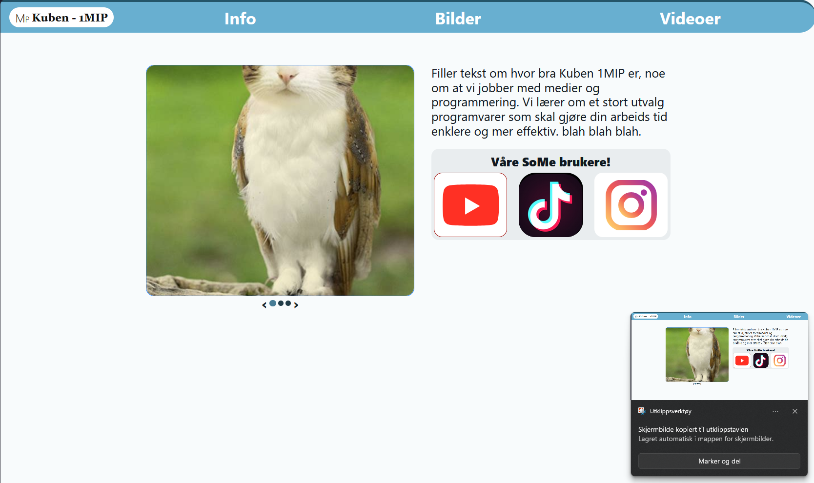

# Dokumentasjon

Denne filen beskriver kravene til nettsiden og løsningen vi har valgt.

## Formål

Nettsiden skal promotere informatikklinja og medielinja (1MIP) på Kuben videregående skole, og lenke til linjenes sosiale medier (Instagram, TikTok, YouTube osv.).

Siden lages og vedlikeholdes av elever i 1. klasse som kan litt HTML, CSS og JavaScript.

## Krav

1. **Én lang side.** Alt innhold ligger på samme side, delt inn i seksjoner.
2. **Navigasjon.** Lenkene i menyen scroller til riktig seksjon.
3. **Fast header og footer.** Headeren og footeren er alltid synlige (sticky/fixed).
4. **Footer.** Siden skal ha en footer. Den mangler i idéskissen.
5. **Én fil per seksjon.** Hver seksjon ligger i sin egen fil, slik at flere elever kan jobbe samtidig uten å komme i konflikt med hverandre.
6. **Enkelt å vedlikeholde.** Oversiktlig og uten unødvendig kode. Ingen rammeverk, ingen installasjon, ingen byggesteg.
7. **Utseende.** Idéskissen (`ideskisse.png`) viser omtrent hvordan siden skal se ut.



## Valgt løsning

Siden lages med **ren HTML og CSS**, pluss **en liten JavaScript-snutt** som henter inn seksjonene.

### Mappestruktur

```
/
├── index.html            ← skallet: header, tomme seksjoner, footer
├── css/
│   ├── felles.css        ← farger, fonter, header og footer
│   ├── info.css
│   ├── bilder.css
│   └── videoer.css
├── seksjoner/
│   ├── info.html
│   ├── bilder.html
│   └── videoer.html
├── js/
│   └── last-seksjoner.js ← henter seksjonene inn i index.html
└── bilder/               ← bilder og ikoner
```

### Slik virker det

`index.html` inneholder bare header, footer og tomme seksjoner. Hver seksjon sier hvilken fil innholdet skal hentes fra:

```html
<section id="bilder" data-fil="seksjoner/bilder.html"></section>
```

`js/last-seksjoner.js` finner alle elementer med `data-fil` og setter inn innholdet fra filen:

```js
document.querySelectorAll("[data-fil]").forEach(async (seksjon) => {
  const svar = await fetch(seksjon.dataset.fil);
  seksjon.innerHTML = await svar.text();
});
```

Seksjonsfilene inneholder bare innholdet i seksjonen. De har ingen `<html>`, `<head>` eller `<body>`.

### Navigasjon, header og footer (CSS)

- Menylenkene er vanlige ankerlenker: `<a href="#bilder">Bilder</a>`.
- `html { scroll-behavior: smooth; }` gir myk scrolling.
- Headeren får `position: sticky; top: 0;`.
- Footeren får `position: fixed; bottom: 0;` og holdes slank.
- `section { scroll-margin-top: ...; }` sørger for at headeren ikke dekker overskriften når man hopper til en seksjon.

### Bildekarusell

Karusellen lages med bare CSS (`scroll-snap`). For å legge til et bilde legger man til én ``-linje.

### Publisering

Siden publiseres med GitHub Pages fra `main`-grenen.

## Viktig å vite

Seksjonene hentes med `fetch()`. Derfor **virker ikke siden hvis du dobbeltklikker på `index.html`**. Bruk utvidelsen **Live Server** i VS Code: høyreklikk på `index.html` og velg *Open with Live Server*. På GitHub Pages virker siden uten videre.
